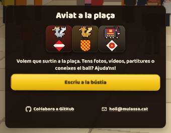
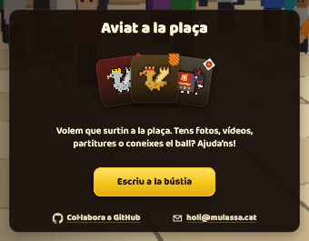

# Case: «Aviat a la plaça» (Mulassa selector, 2026-10-19)

> Since 2026-10-19 the fan is a row of four drawn icons (`src/ui/pending-gifts.js`); the numbers below predate it. The method still applies.

The teaser card shown when the strip's «Pròximament» fold is selected (`#select-pending[data-fold]`, `src/styles/select.css`). Rows: title, a fan of three pending figures, copy, primary «Escriu a la bústia», a row with «Col·labora a GitHub» and the mail link. Its height is fixed to a pending figure's card (`--keep-h`), capped by the room between the town pills and the dock.

| Before (1920×1080) | After |
| --- | --- |
|  |  |

## What was wrong

- The links row had `flex: 1 0 auto` and a 68 px `min-height` (meant for the single-figure card, where it fills the band to the border). In the teaser's `space-between` column it swallowed the free space: copy→button 5 px, button→links 47 px, bottom 50 px.
- Link columns were `1.1fr / 1fr` with an 8 px `gap`: 41 / 80 / 34 px around the two links.
- At 320 px the GitHub label ran under the mail icon: `.btn-compact`'s `min-width: 44px` set the `auto` tracks' minimum, both grew equally to 129 px, and the nowrap label (113 px of text) overflowed.
- A fan squeezed to 1 px left a crumb under the title (the hide-below-31 px container query listed only `svg, img`).
- Landscape phones reserved a two-line title slot for a one-line title: 11 px of slack above it.
- An unclosed `/*` after `.sel-peek {…}` (since commit 6d9e874) disabled the fan's tilt/overlap, the shield corner badge, the copy's `max-width` and the compact primary. Marc chose the original fan (option B of an A/B: compact straight group / original fan / spread across the width).

## What fixed it

- Teaser only: links `flex: none; min-height: 44px`; one-line title slot; `padding-top: max(var(--contact-pad), 14px)` so the air above the title matches the slack under the links' text; `margin-block: 6px` on the copy, because its lines carry no slack while the fan and the links' targets do. Short phones (≤ 519×700/600) and short desktops (≥ 900 wide, ≤ 720 high) drop those extras: gaps come first.
- Shared link row: `repeat(2, auto)` + `justify-content: space-evenly`, 4 px padding on the row and on each link instead of `gap` (equal space at both edges and between), no `width: 100%`; on phones `min-width: min-content` so a column never gets narrower than its words.
- Closed the comment; added `.sel-peek` to the container query.

## Measured ink gaps (top, between rows…, bottom) in px

`pointer: fine` everywhere (desktop browser resized). "HEAD" rows marked * were emulated with an override style that reproduced the real HEAD at 1280×800 and 1920×1080 to within 1 px.

| Viewport | HEAD | After | Links row after |
| --- | --- | --- | --- |
| 1920×1080 | 17 16 14 5 47 50 | 17 28 26 26 27 16 | 51 52 51 (was 41 80 34) |
| 1280×800 | 17 13 11 5 26 28 | 17 13 11 11 13 16 | 51 52 51 |
| 768×1024 | 17 16 14 5 46 50* | 17 28 26 25 27 16 | 51 52 51 |
| 393×852 | 11 12 9 1 42 44* | 15 20 19 17 24 16 | 24 25 24 |
| 375×667 | 7 8 7 −2 20 22 | 7 7 6 4 15 16 | 18 19 18 |
| 320×568 | 7 2 0 −1 11 6, scrolls 7, label clipped 12 | 9 0 0 0 7 8, no scroll, fan hidden | 11 12 11 |
| 667×375 | 18 20 7 0 21 22* | 11 17 15 15 15 7 | 11 12 11 (both wrap to 2 lines) |
| 852×393 | 18 20 7 0 39 42* | 11 23 20 21 28 16 | 13 14 13 |
| 1440×600 | scrolls 27* | scrolls 19 (limit) | 57 58 57 |

Lessons: the residual 6–12 px differences come from the 44 px link target and the tilted fan; they were left visible rather than overlapping a target with the button. 1440×600 cannot fit title + copy + button + links in 148 px even with zero gaps: the cure is the room the dock leaves, not the card.

## Follow-up: the single pending-figure card (same day)

Marc asked to drop the pixel portrait from every single pending card (the strip below already shows it) and to use the room for more of the earlier copy. The panel now has three groups: title + entities, the invitation ("Volem que surti/surtin a la plaça…", verb by the name's number, plus a 14 px open-code note) and the actions. The air between groups is two shrinkable spacers. The link row became a plain 44 px row (no band), and the note goes first on short screens (portrait phones ≤ 700 px tall, desktops ≤ 780 px). Measured gaps (top, title→entity, entity→copy, copy→button, button→links, bottom; line-box based): 1920×1080 11 2 26 25 9 11 (h 290, was 368 with the portrait); 1280×800 11 2 24 24 10 11; 375×667 3 −1 20 20 11 12; 1440×700 fits at 188 px once the spacers cancel their own gap and the button drops to 44 px (7 px over before that). The teaser keeps a pending card's height, so it follows: 290 px at 1920 with a 67 px fan.

Closing decisions (Marc, same day): the teaser keeps following the single card's height; the dead `--copy-air` compensation was removed; the open-code note is now dropped by measurement (`fitPendingNote`: shown, then hidden only if the card would scroll) instead of a height query; short desktop windows got a smaller dock (600–660 px tall: 224 px, 44 px action, 68 px label; 661–700: 284 px) so 1440×600 no longer scrolls. The strip's art kept its size at 600 (42×36) and grew a step at 661–700 (84×72); a first try at 224 px with a 72 px label shrank it to 28×24 and was rejected on the capture, not on the numbers.
