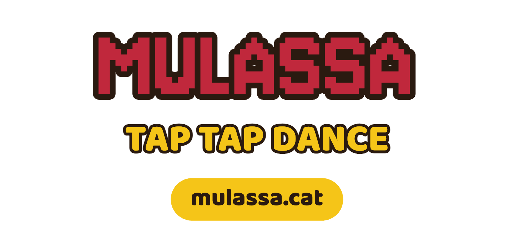
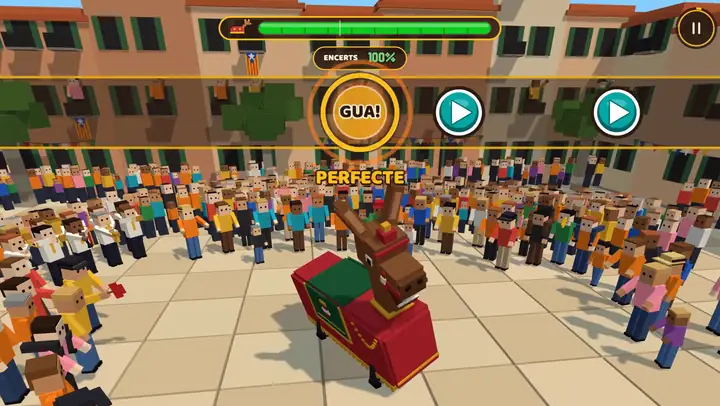
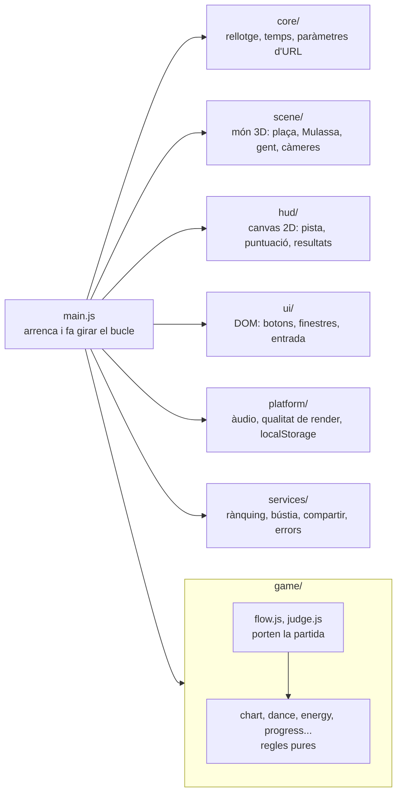
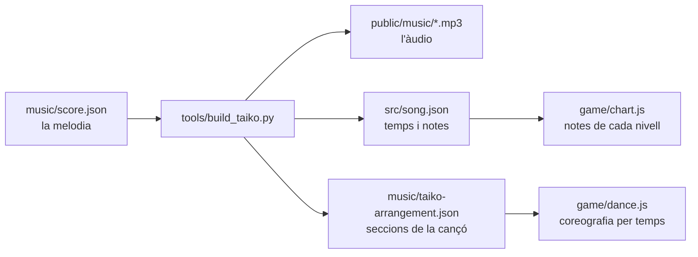

<div align="center">

<a href="https://mulassa.cat">
  <picture>
    <source media="(prefers-color-scheme: dark)" srcset=".github/readme/logo.png">
    
  </picture>
</a>

**Un joc de ritme per al navegador sobre el Ball de la Mulassa de Valls.**

[](https://github.com/mguellsegarra/mulassa-tap-tap-dance/actions/workflows/deploy-pages.yml)
[](LICENSE)
[](https://threejs.org)
[](https://vite.dev)
[](https://supabase.com)
[](https://pages.cloudflare.com)

</div>

La Mulassa és una peça del bestiari popular de Valls i forma part del Seguici Cerimonial de la ciutat. Aquest joc surt amb motiu de la Fira de Santa Úrsula de 2026.

<p align="center"></p>

## Juga

Es juga a **[mulassa.cat](https://mulassa.cat)**, des del navegador del mòbil o de l'ordinador.

## Posar-lo en marxa

Necessites Node 22 (`.node-version`).

```bash
npm install
```

```bash
npm run dev
```

Obre `http://localhost:5178/?mute`. El paràmetre `?mute` treu el so, que és pràctic mentre treballes. Altres paràmetres útils:

| Paràmetre | Què fa |
|---|---|
| `?autoplay` | El joc es juga sol. Va bé per mirar la coreografia. |
| `?from=40` | Comença la cançó al segon 40. |
| `?view=side` | Càmera fixa (`side`, `front`, `back`, `top`) i sense HUD. |
| `?cam` | Editor de càmera per sobre del joc. |
| `?perf` | Mostra fps i temps de render a la consola i a la pantalla. |

Per comprovar que no has trencat res:

```bash
npm run check
```

Tots els tests corren amb Node, sense navegador.

Sense configurar res, el joc funciona complet en local. El rànquing, la bústia de comentaris i els informes d'errors només s'activen si omples les variables de `.env.example` en un `.env.local`.

## Com està fet

No hi ha cap framework. És HTML, CSS i JavaScript amb mòduls, [three.js](https://threejs.org) per al 3D i [Vite](https://vite.dev) per servir-ho i empaquetar-ho.

Hi ha dues capes de dibuix, una sobre l'altra:

- Un `<canvas>` WebGL amb la plaça, la Mulassa, la gent i la banda, tot fet de blocs (vòxels).
- Un `<canvas>` 2D al damunt amb el HUD: la pista de notes, la puntuació, les bombolles de la gent i la pantalla de resultats.

Els menús i les finestres (configuració, rànquing, compartir) són HTML normal a `index.html`.

### Els mòduls

`src/main.js` és el punt d'entrada: importa cada sistema en ordre i fa girar el bucle de frames. Cada carpeta de `src/` té una feina:



Les carpetes depenen les unes de les altres: quan encertes una nota, `judge.js` avisa l'escena, el HUD i l'àudio. Les regles, en canvi, van a part. `chart.js`, `dance.js`, `energy.js`, `progress.js`, `practice.js`, `calibration.js` i `bubble-rules.js` no importen res, ni three.js ni el DOM, i per això els tests les poden provar amb Node.

`tests/modules.mjs` comprova que no hi hagi cicles d'imports, que `main.js` no passi de 400 línies i que cap altre mòdul passi de 600.

### Música, notes i ball surten de la mateixa partitura

La melodia està transcrita a mà a `music/score.json`. Un sol script en Python en genera tota la resta:



Com que l'àudio i les notes surten del mateix lloc, cada toc cau exactament sobre una nota que sents. La coreografia (`src/game/dance.js`) està escrita en temps musicals, no en segons: "al temps 80, mitja volta per ensenyar la part del darrere". Si regeneres la música amb un altre tempo, el ball el segueix sol. `tests/dance.mjs` falla si les seccions de la cançó es mouen i deixen el ball desquadrat.

Per regenerar la música necessites [uv](https://docs.astral.sh/uv/):

```bash
uv run --python 3.11 --with numpy --with scipy --with soundfile --with mido tools/build_taiko.py
```

Els detalls musicals (arranjament, regles de cada tipus de nota) són a [music/README.md](music/README.md).

### Fora del navegador

Tot això és opcional.

- **[Supabase](https://supabase.com)** guarda el rànquing. Els jugadors són anònims i només poden escriure els seus resultats a través de funcions SQL (`supabase/migrations/`). Els tests ho proven amb [PGlite](https://pglite.dev), un Postgres que corre dins de Node.
- **Un [Worker de Cloudflare](https://workers.cloudflare.com)** (`workers/feedback/`) rep els missatges de la bústia i me'ls envia per correu sense guardar-los.
- **[Cloudflare Turnstile](https://www.cloudflare.com/products/turnstile/)** evita que els bots omplin el rànquing o la bústia.
- **[Sentry](https://sentry.io)** recull errors del joc, si hi ha un DSN configurat.
- **[Cloudflare Pages](https://pages.cloudflare.com)** serveix la web. Els workflows de `.github/workflows/` despleguen la web, les migracions i les funcions quan hi ha canvis a `master`.

## Inspiració

La mecànica ve de [Taiko no Tatsujin](https://en.wikipedia.org/wiki/Taiko_no_Tatsujin) ([web oficial](https://taiko-ch.net/)), el joc de ritme de Bandai Namco en què toques un [taiko](https://ca.wikipedia.org/wiki/Taiko), el tambor japonès, al ritme de la cançó. He adaptat els seus tipus de nota a la Mulassa:

| Taiko no Tatsujin | Mulassa Tap Tap Dance |
|---|---|
| *Don*, el cop al centre del tambor (vermell) | **GUA**, botó esquerre |
| *Ka*, el cop a la vora (blau) | **PA**, botó dret |
| Notes grans, amb les dues mans alhora | **GUAPA!**, els dos botons alhora |
| Globus (*fūsen*), redoble fins que rebenta | **GLOBUS** |

Les notes llargues (**MANTÉN**) no existeixen a Taiko. Les he afegit perquè la melodia del Ball de la Mulassa té notes sostingudes que demanaven aguantar el botó. Al codi encara es veu l'origen: el mapa de notes fa servir `don` i `ka` (`src/song.json`).

## Contribueix

Les issues i els pull requests són benvinguts. Abans d'obrir un PR, passa `npm run check`. El fitxer [AGENTS.md](AGENTS.md) té les convencions del codi en detall. El vaig escriure per a agents d'IA, però també serveix per a persones.

### Afegeix la teva figura

Si vols veure un gegant, una àliga, un drac o qualsevol figura del teu poble ballant a la plaça, fes un fork, afegeix-hi el model de la teva figura i obre un PR. De moment el joc només té la Mulassa, però tot arribarà. La idea és que les figures noves es puguin triar i que cadascuna balli amb la seva música.

Abans de començar, mira `?autoplay&mute` una estona per veure com es mou la Mulassa. T'ajudarà a entendre què ha de poder fer la teva figura.

#### El model

Cada figura és un fitxer a `src/scene/models/`. La Mulassa és a `mulassa.js`, i la teva pot anar al costat, per exemple a `drac.js` amb una funció `buildDrac()`. Els models estan fets amb la classe `Vox` de `voxel.js`, que apila caixes de colors i les fusiona en una sola malla:

```js
const v = new Vox();
// x, y (base de la caixa), z, amplada, alçada, fondària, color
v.box(0, 0.5, 0, 1.1, 1.2, 3.3, '#a3182f');
body.add(v.mesh());
```

`box()` rep l'alçada de la base, no del centre, perquè així és més fàcil pensar en blocs apilats. L'eix z positiu és el davant de la figura.

La funció ha de retornar un objecte amb les peces que el joc fa moure. Aquestes són les de la Mulassa:

| Peça | Què és |
|---|---|
| `root` | Tota la figura, que el joc col·loca a la plaça |
| `body` | El cos, que s'inclina i salta |
| `neck`, `head` | Coll i cap, que s'aixequen i giren |
| `jaw` | La mandíbula, per a la mossegada |
| `ears`, `tail` | Orelles i cua |
| `legs` | Les cames dels portadors |
| `peek` | El portador que treu el cap |

Fes servir els mateixos noms encara que la teva figura sigui diferent. Un drac pot tenir `jaw` (per escopir foc) i `tail` (la cua llarga), i les `ears` poden ser banyes. Si una peça no té sentit, crea un `THREE.Group()` buit amb aquest nom. El joc el continuarà movent, però no es veurà.

Indica també l'alçada i la llargada de la figura en metres. El ball les fa servir per calcular quant es desplaça (mira `DANCE_SIZE` a `src/game/dance.js`).

#### La música i el ball

Són opcionals. Si coneixes bé el ball de la teva figura, els pots afegir al mateix PR.

La melodia va en un fitxer com `music/score.json`. Cada compàs és una llista de notes amb la seva durada en negres, i `R` és un silenci:

```json
[1, "C5:1.5 D5:0.5 Eb5:1 F5:1"]
```

La coreografia es descriu en temps musicals, com a `src/game/dance.js`: `YAW` diu cap on mira la figura a cada temps i `STYLE` com es mou (quant s'inclina, si salta, si avança). Mira vídeos del ball real i apunta a quin moment de la música fa cada gir.

Abans d'afegir una melodia, comprova que es pot fer servir. Moltes músiques de bestiari tenen autor i drets.

#### Què ha de portar el PR

- El fitxer del model a `src/scene/models/`.
- L'alçada i la llargada de la figura, en metres.
- Fotos o vídeos de referència de la figura real.
- Si hi ha música, d'on surt la partitura i si es pot fer servir.

## Crèdits

- **Música**: el Ball de la Mulassa és de Francesc Bofarull i Figuerola (1987). La melodia de `music/score.json` es va transcriure a partir de la [reducció per a banda publicada per l'ESMUC](https://www.esmuc.cat/wp-content/uploads/2026/04/AB-Analisi-Partitura-ARRE-2025JU-Partitura_compressed.pdf).
- **La Mulassa**: peça del bestiari de Valls i de la [Unió Anelles de la Flama (UAF) de Valls](https://uaf.cat).
- **Mecànica**: inspirada en Taiko no Tatsujin, de Bandai Namco.
- **Tipografies**: [Baloo 2](https://github.com/EkType/Baloo2) i [Jersey 10](https://github.com/scfried/soft-type-jersey), totes dues amb llicència OFL.
- **3D**: [three.js](https://threejs.org).

## Llicència

© 2026 Marc Güell Segarra · [ondori.dev](https://ondori.dev)

El codi es distribueix amb llicència MIT: el pots copiar, modificar i fer-ne el que vulguis, sempre que mantinguis l'avís de copyright. El text complet és a [LICENSE](LICENSE).

La llicència no inclou la música ni la imatge de la Mulassa. Les tipografies tenen la seva pròpia llicència OFL (`public/fonts/`). Si vols fer servir la música o la imatge fora d'aquest projecte, escriu a holi@mulassa.cat.
