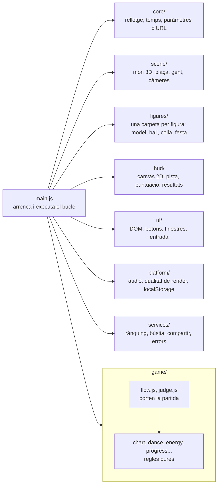
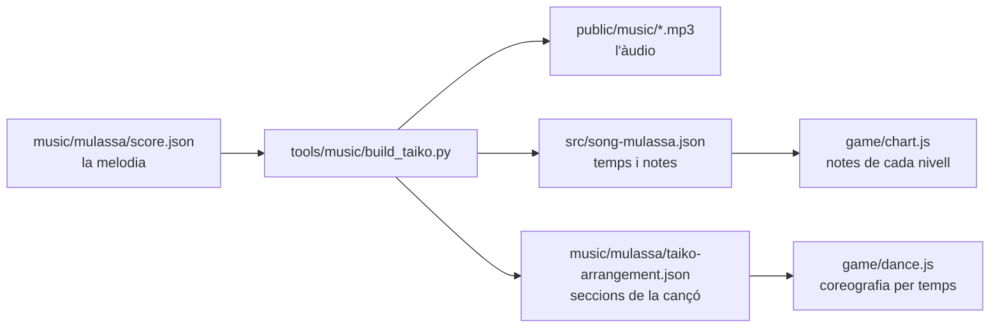
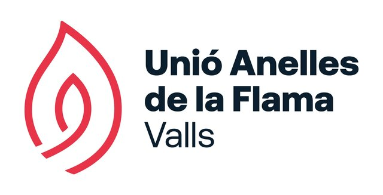

<div align="center">

<a href="https://mulassa.cat">
  <picture>
    <source media="(prefers-color-scheme: dark)" srcset=".github/readme/logo.png">
    
  </picture>
</a>

**El joc de ritme del bestiari festiu català.**<br>Tu posa-hi els dits. Les bèsties ja posen les potes.

[](https://github.com/mguellsegarra/mulassa-tap-tap-dance/actions/workflows/deploy-pages.yml)
[](LICENSE)
[](https://threejs.org)
[](https://vite.dev)
[](https://supabase.com)
[](https://pages.cloudflare.com)

</div>

Mulassa Tap Tap Dance és un joc de ritme gratuït i en català per fer ballar figures del bestiari festiu dels Països Catalans. Marques el ritme de la música amb dos botons mentre la figura balla. Les melodies són les de les figures, però he agafat la llibertat de portar-les al terreny dels videojocs: més desenfadades, amb una estètica de blocs i amb una sorpresa amagada a cada ball. Que les reconeguis, però que en algun moment pensis: "Uala, això al carrer no ho fa!".

Va començar amb la Mulassa de Valls, que forma part del Seguici Cerimonial de la ciutat, i s'ha anat obrint a més figures. Ara hi ha la Mulassa i el Drac, el Bou Tradicional és a punt de sortir i la idea és que s'hi vagin afegint bèsties d'arreu dels Països Catalans. Es pot jugar en 16 llengües, perquè hi pugui jugar qui no parla català.

<p align="center"></p>

## Juga

Es juga a **[mulassa.cat](https://mulassa.cat)**, des del navegador del mòbil o de l'ordinador. El joc també té Instagram: [@mulassa_cat](https://www.instagram.com/mulassa_cat/).

## Posar-lo en marxa

Necessites Node 22 (`.node-version`).

Per executar els tests de backups també cal Python 3.11 o posterior.

```bash
npm install
```

```bash
npm run dev
```

Obre `http://localhost:5178/?mute`. El paràmetre `?mute` silencia el joc mentre treballes. Altres paràmetres útils:

| Paràmetre | Què fa |
|---|---|
| `?autoplay` | El joc es juga sol. Va bé per mirar la coreografia. |
| `?from=40` | Comença la cançó al segon 40. |
| `?view=side` | Càmera fixa (`side`, `front`, `back`, `top`) i sense HUD. |
| `?cam` | Editor de càmera per sobre del joc. |
| `?perf` | Mostra els FPS i els temps de render a la consola i a la pantalla. |

Per comprovar que no has trencat res:

```bash
npm run check
```

Tots els tests s'executen amb Node, sense navegador.

Pots jugar en local sense configurar cap servei. Per activar el rànquing, la bústia de comentaris i els informes d'errors, copia les variables de `.env.example` a `.env.local` i omple les que necessitis.

## Com està fet

No hi ha cap framework. És HTML, CSS i JavaScript amb mòduls, [three.js](https://threejs.org) per al 3D i [Vite](https://vite.dev) per servir-ho i empaquetar-ho.

Hi ha dues capes de dibuix, una sobre l'altra:

- Un `<canvas>` WebGL amb la plaça, la Mulassa, la gent i la banda, tot fet de blocs (vòxels).
- Un `<canvas>` 2D al damunt amb el HUD: la pista de notes, la puntuació, les bombolles de la gent i la pantalla de resultats.

Els menús i les finestres de configuració, rànquing i opcions per compartir són HTML a `index.html`.

### Els mòduls

`src/main.js` és el punt d'entrada: importa cada sistema en ordre i fa girar el bucle de frames. Cada carpeta de `src/` té una feina (hi ha també `i18n/` per als idiomes, `music-form/` per compilar la música i `dev/` per als modes de desenvolupament):



Les carpetes depenen les unes de les altres: quan encertes una nota, `judge.js` avisa l'escena, el HUD i l'àudio. Les regles, en canvi, van a part. `chart.js`, `dance.js`, `energy.js`, `progress.js`, `practice.js`, `calibration.js` i `bubble-rules.js` no depenen ni de three.js ni del DOM (només de mòduls purs com `core/math.js` i els missatges), i per això els tests les poden provar amb Node.

`tests/build/modules.mjs` comprova que no hi hagi cicles d'imports, que `main.js` no passi de 400 línies i que cap altre mòdul passi de 300.

### Música, notes i ball surten de la mateixa partitura

La melodia de cada figura està transcrita a mà (`music/<figura>/`). Aquí, l'exemple de la Mulassa: `music/mulassa/score.json`, i un sol script en Python en genera tota la resta (el Drac té `tools/music/build_drac.py` i el Bou `tools/music/build_bou_chart.mjs`):



Com que l'àudio i les notes surten del mateix lloc, cada toc cau exactament sobre una nota que sents. La coreografia (`src/game/dance.js`) està escrita en temps musicals, no en segons: "al temps 80, mitja volta per ensenyar la part del darrere". Si regeneres la música amb un altre tempo, el ball el segueix sol. `tests/figures/mulassa/dance.mjs` falla si les seccions de la cançó es mouen i deixen el ball desquadrat.

Per regenerar la música necessites [uv](https://docs.astral.sh/uv/):

```bash
uv run --python 3.11 --with numpy --with scipy --with soundfile --with mido tools/music/build_taiko.py
```

Els detalls musicals (arranjament, regles de cada tipus de nota) són a [music/README.md](music/README.md).

### Fora del navegador

Tot això és opcional.

- **[Supabase](https://supabase.com)** guarda el rànquing. Els jugadors són anònims i només poden escriure els seus resultats a través de funcions SQL (`supabase/migrations/`). Els tests ho proven amb [PGlite](https://pglite.dev), un Postgres que s'executa dins de Node.
- **Un [Worker de Cloudflare](https://workers.cloudflare.com)** (`workers/feedback/`) rep els missatges de la bústia i me'ls envia per correu sense guardar-los.
- **[Cloudflare Turnstile](https://www.cloudflare.com/products/turnstile/)** evita que els bots omplin el rànquing o la bústia.
- **[Sentry](https://sentry.io)** recull errors del joc, si hi ha un DSN configurat.
- **[Cloudflare Pages](https://pages.cloudflare.com)** serveix la web. Els workflows de `.github/workflows/` despleguen la web, les migracions i les funcions quan hi ha canvis: cada push a `main` desplega la beta (beta.mulassa.cat) i una etiqueta `vX.Y.Z` desplega mulassa.cat.

## Figures i idiomes

| Figura | Estat |
|---|---|
| Mulassa de Valls | Jugable |
| Drac de Valls | Jugable |
| Bou Tradicional de Valls | Al codi, encara sense publicar |

El selector mostra també altres figures del bestiari com a "aviat", sense música ni model: el catàleg és a [docs/figures/figure-catalog.md](docs/figures/figure-catalog.md).

Els textos del joc són en català i es tradueixen amb catàlegs a `src/i18n/locales/<codi>/` (ara: ca, de, en, es, eu, fr, gl, it, ja, ko, oc, pt, ro, ru, uk i zh-Hans). Per provar l'estructura sense traduir, `?lang=pseudo`. Com s'ha pensat i què queda obert: [docs/i18n/strategy.md](docs/i18n/strategy.md).

## Documentació

Les guies són a `docs/`:

| Tema | On |
|---|---|
| Capes, dependències i com repartir feina | [docs/architecture.md](docs/architecture.md) |
| Estructura de `src/` i fitxers generats | [docs/agents/structure.md](docs/agents/structure.md) |
| Figures: música, ball, model, integració | [docs/figures/](docs/figures/) |
| Escena: càmera de joc, plaça i gent, render | [docs/scene/](docs/scene/) |
| Selector i joc lliure | [docs/ui/](docs/ui/) |
| Rànquing, temporades i desplegament | [docs/rankings/](docs/rankings/) |
| Còpies de seguretat i Sentry | [docs/ops/](docs/ops/) |
| Idiomes | [docs/i18n/](docs/i18n/) |

### Versions i llançaments

`main` és l'única branca llarga. Cada push a `main` desplega la beta (beta.mulassa.cat, amb el seu Supabase de proves) i una etiqueta `vX.Y.Z`, igual a la versió de `package.json`, desplega mulassa.cat. Les etiquetes les confirma el propietari una per una. El detall és a [AGENTS.md](AGENTS.md).

## Inspiració

La mecànica ve de [Taiko no Tatsujin](https://en.wikipedia.org/wiki/Taiko_no_Tatsujin) ([web oficial](https://taiko-ch.net/)), el joc de ritme de Bandai Namco en què toques un [taiko](https://ca.wikipedia.org/wiki/Taiko), el tambor japonès, al ritme de la cançó. He adaptat els seus tipus de nota a la Mulassa:

| Taiko no Tatsujin | Mulassa Tap Tap Dance |
|---|---|
| *Don*, el cop al centre del tambor (vermell) | **GUA**, botó esquerre |
| *Ka*, el cop a la vora (blau) | **PA**, botó dret |
| Notes grans, amb les dues mans alhora | **GUAPA!**, els dos botons alhora |
| Globus (*fūsen*), redoble fins que rebenta | **GLOBUS** |

Les notes llargues (**MANTÉN**) no existeixen a Taiko. Les he afegit perquè la melodia del Ball de la Mulassa té notes sostingudes que demanaven aguantar el botó. Al codi encara es veu l'origen: el mapa de notes fa servir `don` i `ka` (`src/song-mulassa.json`).

## Contribueix

Pots obrir una issue per avisar d'un problema o proposar un canvi, o enviar un pull request. Abans d'obrir un PR, executa `npm run check`. Les convencions del codi són a [AGENTS.md](AGENTS.md).

### Afegeix la teva figura

El codi és obert i el joc vol créixer amb bèsties de tot arreu. Si vols veure un gegant, una àliga o qualsevol figura del teu poble ballant a la plaça, la pots portar al joc. Ara hi ha la Mulassa i el Drac, i el Bou Tradicional arriba aviat. Cada figura té el seu model vòxel, la seva música, el seu ball, la seva colla, les seves paraules als botons i la seva festa.

La guia [docs/figures/nova-figura.md](docs/figures/nova-figura.md) explica:
- què has d'aportar abans de començar (vídeos sencers del ball, partitura, fotos de la colla);
- les fases de la feina, de la música fins a la validació;
- on va cada peça, des dels retrats fins a les tecles del joc lliure;
- una plantilla per omplir a la PR.

Abans d'afegir una melodia, comprova que es pot fer servir: moltes músiques de bestiari tenen autor i drets.

## Crèdits

Amb la col·laboració de la [Unió Anelles de la Flama (UAF) de Valls](https://uaf.cat), que m'ha donat permís per portar les seves figures al joc. El que he fet neix de la feina de la gent de l'entitat que les cuida i les fa sortir a plaça.

<p align="center"><a href="https://uaf.cat"></a></p>

- **Música**: el Ball de la Mulassa és de Francesc Bofarull i Figuerola (1987). La melodia de `music/mulassa/score.json` es va transcriure a partir de la [reducció per a banda publicada per l'ESMUC](https://www.esmuc.cat/wp-content/uploads/2026/04/AB-Analisi-Partitura-ARRE-2025JU-Partitura_compressed.pdf).
- **Música del Drac**: el Ball del Drac de Valls és de Francesc (Cisco) Bofarull i Figuerola (1985). La melodia de `music/drac/drac-score.json` es va transcriure a partir de la [partitura publicada pels Grallers d'Alfés](https://grallersalfes.wordpress.com/wp-content/uploads/2014/01/ball-del-drac-de-valls.pdf).
- **La Mulassa**: peça del bestiari de Valls, de la Unió Anelles de la Flama.
- **Mecànica**: inspirada en Taiko no Tatsujin, de Bandai Namco.
- **Tipografies**: [Baloo 2](https://github.com/EkType/Baloo2) i [Jersey 10](https://github.com/scfried/soft-type-jersey), totes dues amb llicència OFL.
- **3D**: [three.js](https://threejs.org).

## Convida'm a un cafè

Si el joc t'ha fet somriure, **[convida'm a un cafè](https://buymeacoffee.com/mguellsegarra)!**

## Llicència

© 2026 Marc Güell Segarra · [ondori.dev](https://ondori.dev)

El codi es distribueix amb llicència MIT: el pots copiar, modificar i fer-ne el que vulguis, sempre que mantinguis l'avís de copyright. El text complet és a [LICENSE](LICENSE).

La llicència no inclou la música ni la imatge de la Mulassa. Les tipografies tenen la seva pròpia llicència OFL (`public/fonts/`). Si vols fer servir la música o la imatge fora d'aquest projecte, escriu a holi@mulassa.cat.
