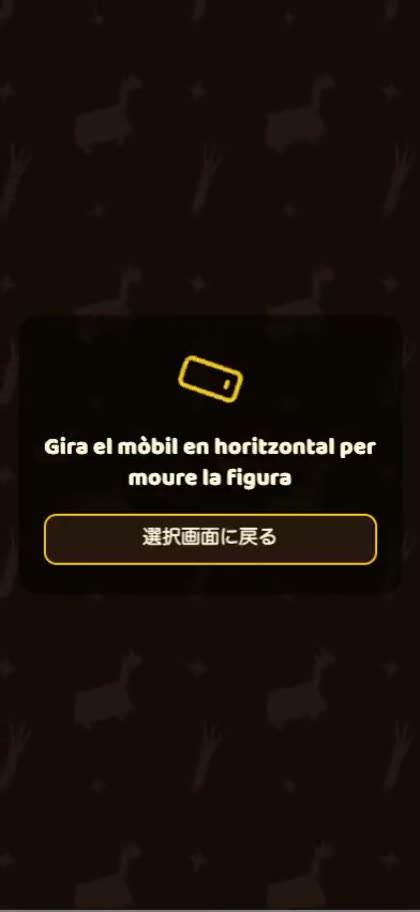
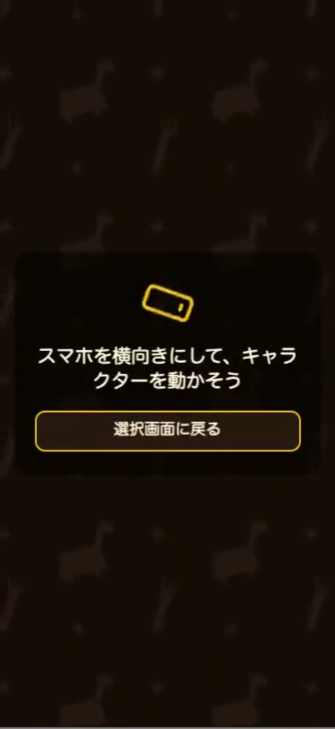
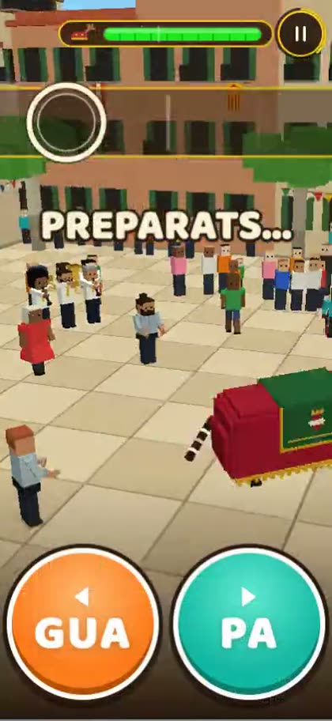
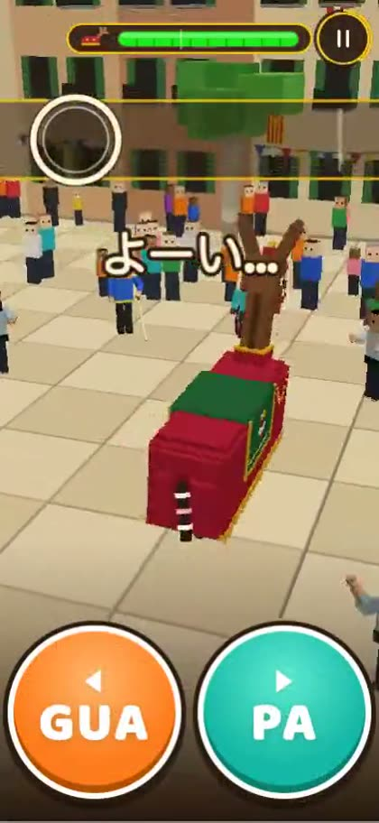
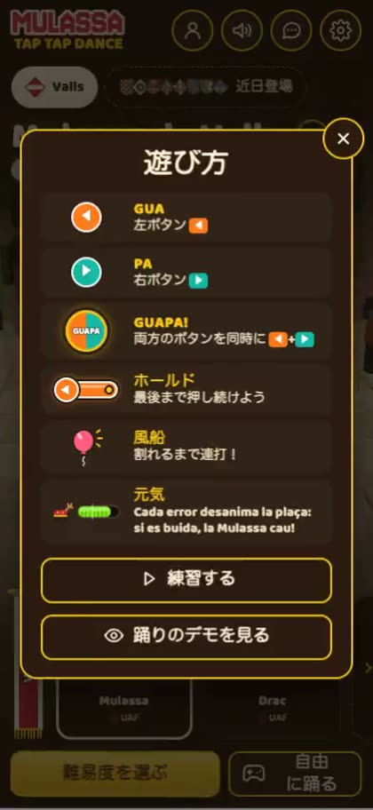
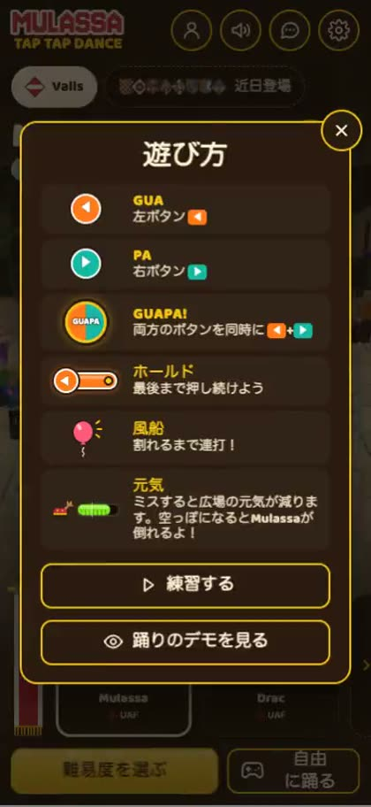

# Inventari de moviment (vídeo) de la UI — i18n

Generat per `tools/ui-video.mjs` · 2026-10-22 03:34 · 341 clips «abans» + 341 «després» · 178 MB d'mp4. Resultats complets a `findings-video.json` (abans) i `findings-video-despres.json`; el triatge, a `triatge.json`. PDF: `../inventari-video.pdf`.

Tot amb `?mock` i `?mute`, Chromium amb swiftshader. Cada unitat (escena × viewport × idioma) es grava en **un** vídeo de Playwright des de la càrrega i es talla en un clip per escena (4–14 s) amb una interacció mínima (obrir/tancar la fulla, canviar de carta, prémer un nivell, deixar córrer la partida, tornar enrere, canviar d'idioma i recarregar).

## Codis

`M<nn>-V<n>-<idioma>[-<variant>]` (M = moviment). `<nn>`, `V<n>`, idioma i variant són els de la captura estàtica `S<nn>-V<n>-<idioma>[-<variant>]` (`../shots/`): `M03-V3-ja` és el moviment de `S03-V3-ja`. Els clips «després» afegeixen `-despres` (`M05-V3-ja-despres.mp4`). Variant nova: `-switch` (M06: canvi d'idioma des de ⚙).

| M | S | Escena |
| --- | --- | --- |
| M01 | S01 | Splash («TOCA AQUÍ PER ENTRAR») — càrrega de la pàgina; espera la coberta aixecada |
| M02 | S02 | Selector, pas 1 (Mulassa) — Enter a la splash → G.state=select |
| M03 | S03 | Selector, pas 2 (nivells) — pas 1 → #select-next («TRIA DIFICULTAT») |
| M04 | S04 | Figura pendent (informació inline) — pas 1 → pastilla d’una vila amb figures pendents (Tarragona) |
| M05 | S05 | Mode foto (joc lliure) — pas 1 amb figura jugable → #select-free |
| M06 | S06 | ⚙ Configuració (amb selector d’idioma) — clic a #settings |
| M07 | S07 | Com es juga — clic a #howto (o #select-howto) |
| M08 | S08 | Ajusta la sincronia — ⚙ → #settings-sync |
| M09 | S09 | Pausa — a la pràctica, Escape → #pause-menu |
| M10 | S10 | Pràctica — selector → __dbg.startPractice() |
| M11 | S11 | Partida (HUD + carril) — ?autoplay&from=40 + tutorial fet → __dbg.choose(1) |
| M12 | S12 | Col·lapse — a la partida, __dbg.collapse() |
| M13 | S13 | Resultats (2 estrelles) — stars=2; espera els resultats |
| M14 | S14 | Compartir (Història 9:16) — ?final → «Publica el teu resultat» → «Ara no» → s’obre Comparteix |
| M15 | S15 | Classificació — ?final&review=board |
| M16 | S16 | Perfil — ?final&review=profile-guest |
| M17 | S17 | Saló de la fama — ?final&review=seasons |
| M18 | S18 | Fi de temporada — ?final&review=season-end |
| M19 | S19 | Fitxa de jugador — ?final&review=card |
| M20 | S20 | Feedback (Bústia) — clic a #feedback |
| M21 | S21 | Privadesa — ⚙ → #settings-privacy |
| M22 | S22 | Publica el teu resultat — ?final&review=publish |
| M23 | S23 | Avís d’estadístiques — ?mock&account=guest sense stats-notice vist → greeting al selector |
| M24 | S24 | Consell de dispositiu: acceleració per maquinari — WebGL en programari (swiftshader) → greeting al selector inactiu |
| M25 | S25 | Carregador (Avisant a la brigada…) — càrrega, captura a ~1 s abans que el carregador s’aixequi |
| M26 | S26 | Suggeriment d’idioma (navigator.languages=es, sense desat) — context locale es-ES sense ?lang ni desat → #lang-tip a la splash |
| M27 | S27 | Avís d’idioma no carregat (ja) — ?lang=ja amb el paquet del català bloquejat → #lang-notice |
| M28 | S28 | Coberta «gira el mòbil» (tàctil) — context tàctil (hasTouch) en un viewport horitzontal/tauleta + mode foto |
| M29 | S29 | Selector, pas 2: podi del nivell amb el teu nom — ?mock&board=me → pas 2 (#select-podium, només ≥ 600×600) |
| M30 | S30 | Classificació després del salt (#board-jump) — ?final&review=board → clic a #board-jump (al capdamunt: l’enllaç passa a «A la meva fila») |
| M31 | S31 | Aviat a la plaça (panell del plec, sense figura) — pas 1 → clic a la targeta del plec (.sel-more): el panell pendent mostra la invitació |

## Cobertura

| Viewport | Mida | Punter | Idiomes |
| --- | --- | --- | --- |
| V3 | 393×852 | tàctil | ca de ja ru es pseudo |
| V7 | 1280×800 | fi | ca de ja ru |
| V5 | 852×393 | fi (la coberta tàctil és M28) | ca |

## Mesures automàtiques (per clip)

- **CLS**: `PerformanceObserver` `layout-shift` (sense `hadRecentInput`), amb els nodes causants i el seu moviment en px; avís ≥ 0,05, error ≥ 0,1 (`cls`, `clsLoad`, `shifts`, `nodes`).
- **Fonts**: canvis de família efectiva (`body`, `.btn`, `#select-name`…) i `document.fonts` `loadingdone`; «font tardana amb salt» = font carregada amb la pantalla visible i CLS > 0.
- **Flaix de català**: paraules catalanes visibles (fora de `.sr-only` i `[lang=ca]`) en una pàgina d'un altre idioma durant els primers 25 s.
- **Text català sense traduir**: text visible, atributs, text de canvas i `content:` de pseudoelements iguals a una cadena del catàleg català que en l'idioma de la pàgina té una altra traducció.
- **Parpelleigs**: DOM (opacitat/visibilitat/display A→B→A en < 200 ms, mostreig de 50 ms) i vídeo (salts de lluminositat que tornen en < 0,25 s); **fotogrames en blanc/negre** un cop hi ha contingut.
- **Últim estat vs captura estàtica**: SSIM de la fulla oberta (retallada) contra `S<nn>…png`, el millor de tres fotogrames.

## Notes de mètode i límits

- El fullscreen d'Android tàctil s'anul·la durant la gravació: en headless redimensiona la superfície a 800×600 i el clip surt reduït en un racó (descobert amb el primer intent).
- L'hora del clip es calibra amb la durada del vídeo cru (±0,3 s). El 3D va per programari: la partida i el selector van a pocs fotogrames per segon, sobretot a 1280×800.
- Cap escena fabrica una partida real (autoplay, `?final`, `?stars`, mock en memòria). No emulat: tàctil real, Safari/iOS, DPR > 1.

## Troballes

Abans: 390 (A 198 · B 22 · C 170). Després: 185 (A 0 · B 22 · C 163).

A = defecte nou de la feina d'i18n o de la fusió (arreglat); B = preexistent o de disseny (anotat); C = fals positiu o soroll.

| Gr. | Tipus | Abans | Després | Estat i motiu |
| --- | --- | --- | --- | --- |
| A | catala-sense-traduir | 194 | 0 | arreglat: «PREPARATS…» del compte enrere estava escrit al HUD (banner.js, warm.js) i es veia en català en totes les llengües: ara hud.banner.ready |
| A | catala-sense-traduir | 4 | 0 | arreglat: la fila ÀNIM de «Com es juga» i les etiquetes aria dels botons GUA/PA es quedaven amb el text de reserva català: el tema per defecte (Mulassa) mai dispara el canvi de figura i no s'aplicava |
| B | cls-error | 10 | 10 | anotat: selector nou: en obrir una figura pendent o la targeta del plec la tira i la fila de pobles es reordenen d'un cop (canvi de gestió d'amplada de la UX del character select); és d'abans de l'i18n i cal decidir-ne el disseny (animar-ho en lloc de saltar) |
| B | font-tardana-amb-salt | 1 | 1 | anotat: Baloo 2 (600/800) arriba amb la pantalla ja visible a 1 de 341 clips (de, 1280×800); no hi ha salt de text mesurable |
| B | cls-avis | 1 | 1 | anotat: Classificació: la targeta de posició (87 px) apareix quan arriba la resposta i empeny la llista; CLS 0,053, just per sobre de l'avís, igual en tots els idiomes |
| B | cls-error | 10 | 10 | anotat: Perfil: la fulla s'obre curta («Encara no has jugat cap partida») i creix a l'alçada màxima quan arriben les estadístiques del servidor; no té a veure amb l'idioma. Recomanació: mostrar l'estat de càrrega dins del bloc d'estadístiques i reservar-ne l'alçada |
| C | parpelleig-video | 2 | 8 | fals positiu: salt de lluminositat en passar de la splash al selector (el títol s'esvaeix i entra el degradat del selector) o en obrir-se un consell: transició dissenyada, 1–2 fotogrames |
| C | final-vs-estatica | 89 | 85 | soroll de la mesura: l'últim estat del vídeo es compara amb la captura estàtica: la compressió del vídeo, l'animació de la fulla i el rellotge del clip (±0,3 s) donen SSIM baix; els fotogrames revisats a ull coincideixen |
| C | cls-menor | 55 | 52 | soroll: CLS < 0,05 (icones, línies d'1–20 px i vores de pseudoelements); no es veu a ull |
| C | parpelleig-dom | 11 | 6 | fals positiu: una fulla tancada i la següent oberta en menys de 50 ms (de Configuració a Sincronia/Privadesa) o la barreja d'opacitat d'#select-info; el mostrador de 50 ms no distingeix un parpelleig d'un canvi de fulla |
| C | catala-sense-traduir | 3 | 0 | fals positiu: text de ::before/::after que ve d'attr() (#board-jump) i ja és al idioma de la pàgina |
| C | catala-sense-traduir | 4 | 4 | fals positiu: targeta d'error de càrrega: el paquet principal està bloquejat a propòsit, així que mai no corre el JS que aplica l'idioma (el HTML de reserva és català); no es veu |
| C | canvis-de-font | 4 | 5 | fals positiu: recàrrega de l'idioma: durant la recàrrega la família efectiva passa per la de reserva (Times) i les fonts locals; només es veu el carregador |
| C | catala-sense-traduir | 2 | 2 | fals positiu: després del canvi d'idioma la pàgina ja és a l'idioma d'arribada (català); l'eina compara amb l'idioma de sortida |
| C | catala-sense-traduir | 0 | 1 | fals positiu: S27: el paquet de l'idioma falla a propòsit i el joc es queda en català amb l'avís; és el comportament dissenyat |

## Què s'ha tocat

### A1 · Coberta «gira el mòbil»: text només en català

Les tres frases («Gira el mòbil en vertical per jugar», «…en horitzontal per moure la figura», «Gira la tauleta…») eren `content:` al CSS i es veien en català a totes les llengües (el clip M05-V3-ja ho mostrava amb el botó en japonès). Ara són tres <span data-i18n> dins #rotate b i el CSS només tria quin es veu (mòbil, tauleta, mode foto). Claus noves html.rotate.photo/play/tablet a les 16 llengües (traduccions d'una passada: cal revisió nativa).

- Mesures: M05-V3-ja: la frase de la coberta era catalana tot el clip; ara és japonesa. Cap canvi de layout (el contenidor és el mateix; abans ::after, ara el mateix <b>).
- Fitxers: `index.html`, `src/styles/base.css`, `src/i18n/locales/*/html.json (3 claus × 16)`, `tests/i18n.mjs`
- Prova: tests/i18n.mjs (l): cap `content:` amb paraules al CSS; falla amb el CSS antic
- M05-V3-ja:  

### A2 · «PREPARATS…» del compte enrere, sempre en català

El compte enrere de la partida pintava la cadena fixa «PREPARATS…» (hud/banner.js i la pre-pintada de hud/warm.js). Ara usa la clau hud.banner.ready (16 llengües), llegida una vegada com GO_WORD (cap tr() per fotograma).

- Mesures: M11-V3-ja: «PREPARATS…» durant ~3 s del compte enrere → «よーい…». Els 207 «text del catàleg català en una altra llengua» de les 341 passades baixen a 7, tots falsos positius (C).
- Fitxers: `src/hud/banner.js`, `src/hud/warm.js`, `src/i18n/locales/*/hud.json (1 clau × 16)`
- Prova: tests/i18n.mjs (a): paritat de claus; (k): amplada del HUD ≤ 1,3×
- M11-V3-ja:  

### A3 · Fila ÀNIM de «Com es juga» i etiquetes aria GUA/PA en català

figure-theme-dom.js només aplicava els textos del tema de la figura en canviar de figura; el tema per defecte (Mulassa) no dispara cap canvi, així que el text de reserva del HTML («Cada error desanima la plaça…») i els aria-label dels botons es quedaven en català en totes les llengües. Ara s'apliquen una vegada en carregar el mòdul i en cada canvi.

- Mesures: M07-V3-ja: la fila ÀNIM era catalana → japonesa; aria-label «GUA, esquerra»/«PA, dreta» → traduïts a les 207 passades afectades.
- Fitxers: `src/ui/figure-theme-dom.js`, `tests/figure-theme.mjs`
- Prova: tests/figure-theme.mjs: el text d'ÀNIM és el de trf('help.energy') en carregar (falla sense la línia apply(figTheme))
- M07-V3-ja:  

## Reexecutar

```
node tools/ui-video.mjs --jobs=3                                  # abans (construeix /tmp/ui-inv-dist)
node tools/ui-video.mjs --dist=/tmp/ui-inv-dist-after --tag=despres # després
node tools/ui-video-readme.mjs && node tools/ui-video-pdf.mjs
```
